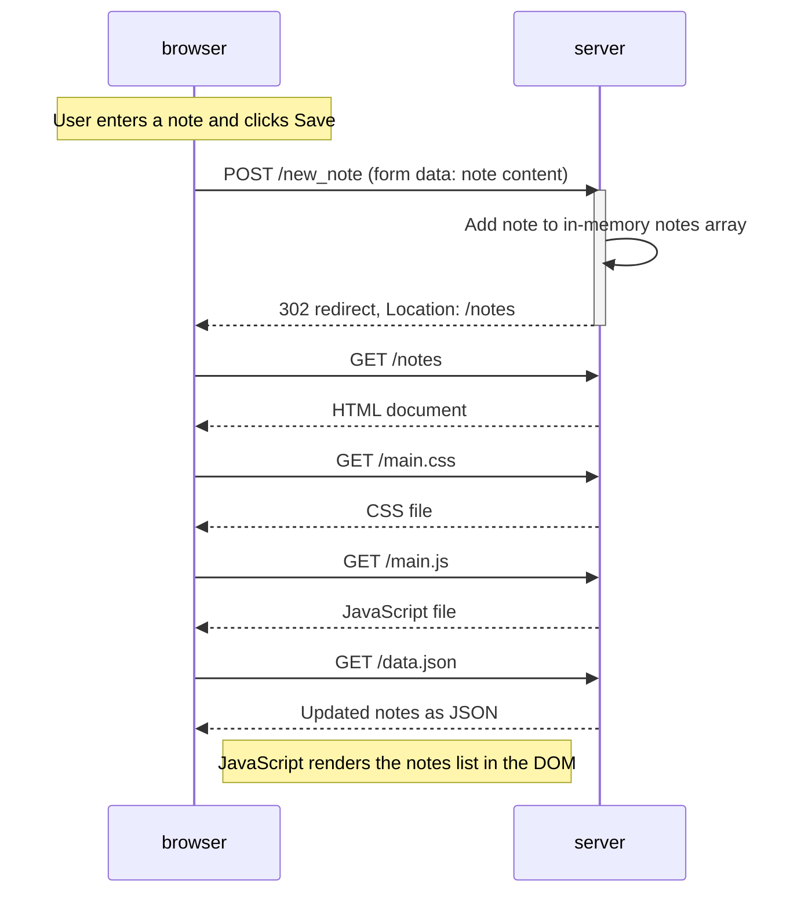
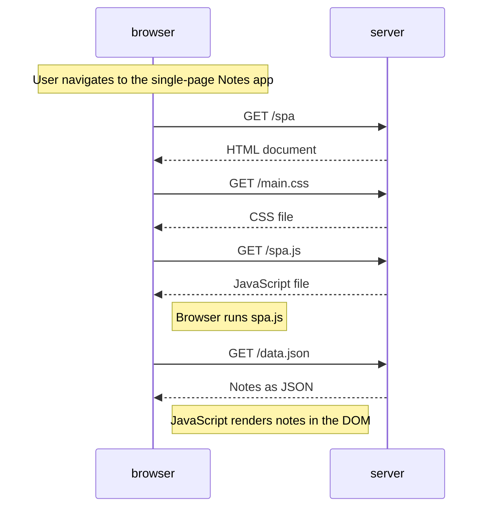
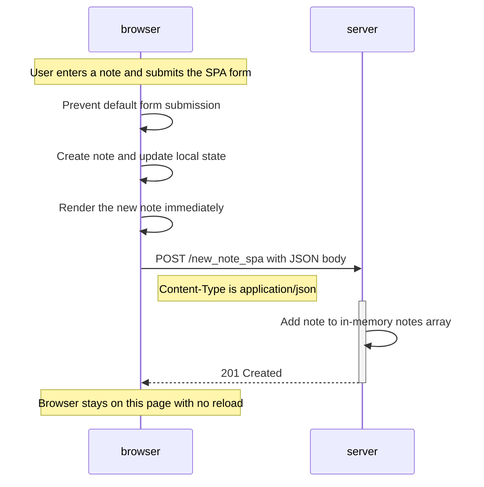

# Full Stack Open — Part 0: Fundamentals of Web apps

## Exercises 0.1–0.3

Reading-only refreshers completed: HTML, CSS, and HTML forms.

## 0.4: New note diagram

## 0.5: Single page app diagram

## 0.6: New note in Single page app diagram

